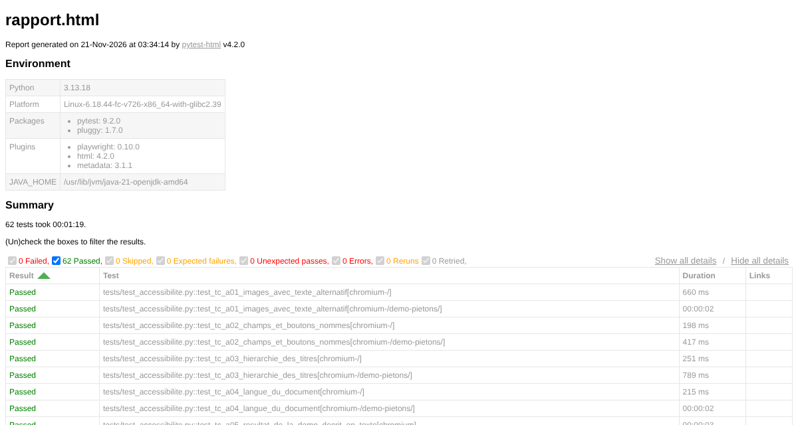

# Rapport d'exécution

## Campagne du 21 novembre 2026

| | |
|---|---|
| Version testée | Portfolio, commit `34728d7` (servi localement, contenu identique au site en production) |
| Navigateurs | Chromium 159 et Firefox 159 (Playwright 1.65) |
| Outils | Python 3.13, pytest 9.2, pytest-playwright 0.10 |
| Exécutions | 62 (31 par navigateur), hors tests de liens externes |
| Résultat | **62 réussis, 0 échec**, en 79 secondes |

Les 4 exécutions du test de liens (TC-L01) ont été vérifiées séparément : tous les liens répondent normalement, et LinkedIn renvoie le code 999 qu'il réserve aux robots, toléré par le test. Ce test tourne dans l'intégration continue, où les sites tiers sont joignables.

## Vérification des tests de non-régression

Pour s'assurer que les tests détectent bien les défauts qu'ils couvrent, la suite a aussi été lancée sur la version précédente du site (commit `c902564`), avant la correction des défauts DEF-004 à DEF-007. Six exécutions échouent, comme attendu :

| Test | Défaut | Cause de l'échec sur l'ancienne version |
|---|---|---|
| TC-A03 (page d'accueil) | DEF-006 | Titre H4 placé sous un H2 |
| TC-A05 | DEF-004 | `canvas` sans rôle ni nom accessible |
| TC-D05 | DEF-005 | Aucun message pour un fichier texte |
| TC-P10 (démo) | DEF-007 | Pas de balise `og:image` |
| TC-D03, TC-D04 | DEF-004 | Ces deux tests lisent la description textuelle du résultat ajoutée par la correction |

Sur la version corrigée, ces tests réussissent.

## Rapports produits par l'intégration continue

Chaque exécution de GitHub Actions publie, pour chaque navigateur, un rapport HTML (`pytest-html`), un rapport JUnit et, en cas d'échec, les captures d'écran et les traces Playwright. Une trace s'ouvre avec `playwright show-trace trace.zip`. Ces fichiers sont disponibles dans l'onglet *Actions* du dépôt, section *Artifacts*.
