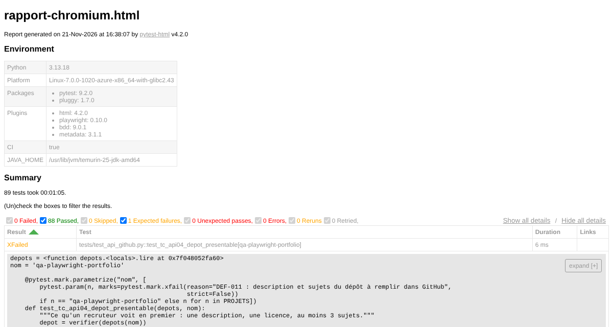

# Rapport d'exécution

## Campagne du 21 novembre 2026 (tests d'API, tests HTTP et scénarios BDD)

| | |
|---|---|
| Version testée | Portfolio, commit `1cf0f2d` (carte du projet QA, bouton de langue corrigé), site en production |
| Intégration continue | GitHub Actions, run `44925483436`, sur la branche `api-bdd` avant la fusion dans `main` |
| Chromium | **88 réussis, 1 échec attendu** (TC-API04 pour DEF-011), 0 échec, en 65 secondes |
| Firefox | **58 réussis**, 31 sautés (tests d'API et HTTP, exécutés une seule fois, dans la tâche Chromium), 0 échec |
| Outils | Python 3.13, pytest 9.2, pytest-playwright 0.10, pytest-bdd 9.0, jsonschema 4.26 |

Nouveaux cas : TC-API01 à TC-API07, TC-H01 à TC-H05, TC-A06, et 5 scénarios BDD (2 fonctionnalités). TC-P02 cherche désormais le bouton de langue par son texte exact.

**Défauts trouvés :**

| Défaut | Trouvé par | Suite donnée |
|---|---|---|
| DEF-011 : dépôt des tests sans description ni sujets | TC-API04 | Ouvert ; test marqué `xfail` avec la référence du défaut |
| DEF-012 : le projet de tests absent du portfolio | TC-API01 (liste des projets ≠ liens de la page) | Corrigé ; TC-API01 réussit |
| DEF-013 : nom accessible du bouton de langue différent du texte visible | Scénario BDD « Lire le portfolio dans ma langue » (délai dépassé en cherchant « English ») | Corrigé ; TC-A06 échouait sur la version d'origine |

**Problèmes des tests eux-mêmes, corrigés pendant la mise au point :**
- TC-H04 lisait la taille compressée du modèle (9 Mo au lieu de 15 Mo) : Playwright accepte gzip. Correction : `Accept-Encoding: identity`.
- Sans jeton, l'API GitHub limite à 60 requêtes par heure et par adresse IP ; en développement, la limite a été atteinte. Correction : jeton `GITHUB_TOKEN` en CI, cache des réponses, message d'échec explicite.
- L'étape BDD générique « j'envoie {fichier} » captait aussi « j'envoie l'image de référence ». Correction : expression régulière limitée aux valeurs prévues.
- Le titre de section bilingue contenait les deux langues dans son texte (`ProjetsProjects`) ; l'étape vérifie maintenant le nom accessible, qui ne contient que la langue affichée.

## Campagne du 21 novembre 2026 (ajout de la démo des pièces)

| | |
|---|---|
| Version testée | Portfolio, commit `370e2e2` : ajout de `/demo-pieces/` et du lien depuis la carte du projet |
| Exécution locale | Chromium, copie locale du site : 46 réussis sur 46 (hors tests de liens), en 90 secondes |
| Intégration continue | GitHub Actions, run `44908632517`, site en production : **49 réussis sur Chromium, 49 sur Firefox**, tests de liens compris |

Nouveaux cas : TC-C01 à TC-C09 (démo des pièces). Cas étendus à la nouvelle page : TC-P04 (lien de chaque carte vers sa démo), TC-P10 (image d'aperçu), TC-A01 à TC-A04 (accessibilité), TC-L01 (liens).

**Défauts trouvés pendant la mise au point de la démo** (avant la mise en ligne) :

| Défaut | Trouvé par | Vérification du test de non-régression |
|---|---|---|
| DEF-008 : barres de probabilité vides | Capture d'écran pendant l'écriture de TC-C04 | TC-C04 échoue sur la version d'origine (largeur de barre nulle) |
| DEF-009 : pourcentage coupé sur deux lignes | Même capture | TC-C05 échoue sur la version d'origine (hauteur 46,5 px pour une ligne de 23,25 px) |
| DEF-010 : probabilité élevée pour une image qui n'est pas une pièce | Image synthétique de TC-C02 classée « 2 roupies » à 98,5 % | Limite du modèle, acceptée ; avertissement ajouté sur la page |

**Cohérence du modèle :** sur l'image synthétique, les probabilités calculées dans Chromium diffèrent de celles calculées en Python de moins de 0,000001 (tolérance du test : 0,001). Sur 40 photos de test du jeu ICDD, vérifiées localement et non publiées, la démo donne la même classe que le modèle Keras pour 37 : les 3 écarts viennent de la compression du modèle et de l'interpolation utilisée pour réduire les photos.

## Campagne du 21 novembre 2026 (première version)

| | |
|---|---|
| Version testée | Portfolio, commit `34728d7` (servi localement, contenu identique au site en production) |
| Navigateurs | Chromium 159 et Firefox 159 (Playwright 1.65) |
| Outils | Python 3.13, pytest 9.2, pytest-playwright 0.10 |
| Exécutions | 62 (31 par navigateur), hors tests de liens externes |
| Résultat | **62 réussis, 0 échec**, en 79 secondes |

Les 4 exécutions du test de liens (TC-L01) ont été vérifiées séparément : tous les liens répondent normalement, et LinkedIn renvoie le code 999 qu'il réserve aux robots, toléré par le test. Ce test tourne dans l'intégration continue, où les sites tiers sont joignables.

## Vérification des tests de non-régression

Pour s'assurer que les tests détectent bien les défauts qu'ils couvrent, la suite a aussi été lancée sur la version précédente du site (commit `c902564`), avant la correction des défauts DEF-004 à DEF-007. Six exécutions échouent, comme attendu :

| Test | Défaut | Cause de l'échec sur l'ancienne version |
|---|---|---|
| TC-A03 (page d'accueil) | DEF-006 | Titre H4 placé sous un H2 |
| TC-A05 | DEF-004 | `canvas` sans rôle ni nom accessible |
| TC-D05 | DEF-005 | Aucun message pour un fichier texte |
| TC-P10 (démo) | DEF-007 | Pas de balise `og:image` |
| TC-D03, TC-D04 | DEF-004 | Ces deux tests lisent la description textuelle du résultat ajoutée par la correction |

Sur la version corrigée, ces tests réussissent.

## Rapports produits par l'intégration continue

Chaque exécution de GitHub Actions publie, pour chaque navigateur, un rapport HTML (`pytest-html`), un rapport JUnit et, en cas d'échec, les captures d'écran et les traces Playwright. Une trace s'ouvre avec `playwright show-trace trace.zip`. Ces fichiers sont disponibles dans l'onglet *Actions* du dépôt, section *Artifacts*.
